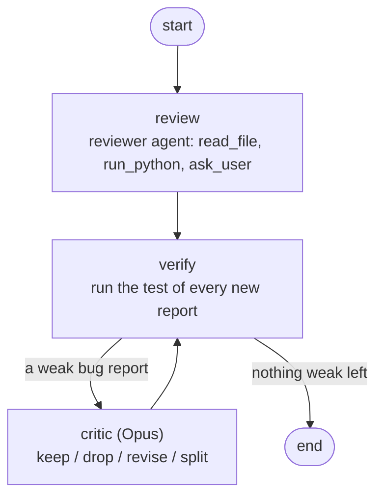

# Code Reviewer

[](https://github.com/Assaf368/code-reviewer/actions/workflows/tests.yml)

An AI code review agent built with [LangChain](https://docs.langchain.com). It reads a Python file and returns a structured review: each issue has a line number, a category, a severity, an explanation and a suggested fix.

Every reported bug also comes with an assert-based test. The model writes the test, but the project's own code runs it and decides whether the bug is real. A bug that is not proven by its test is shown as unproven.

When the code does not say what it is supposed to do, the reviewer can pause and ask the user, then continue the review with the answer. Bug reports that verification could not prove go to a stronger model, a critic, which keeps, drops, fixes or splits them. Only those reports reach it, so it runs on a small share of reviews.

The project is built in stages, starting from a single agent and growing into a multi-agent system orchestrated with LangGraph.

## Example output

A real review of [`evals/dataset/store.py`](evals/dataset/store.py), a 200-line file with three planted bugs:

```
3 of 3 reported bugs confirmed, 0 crashed, 0 not reproduced, 0 need a manual check, 1 other issues.

[CRITICAL] line 180 · bug · charged_amount records the raw subtotal, not the amount charged ✓ confirmed
    The docstring says charged_amount is the amount actually charged, as returned by
    calculate_total. The code stores raw_subtotal, which has no discount and no tax.
    Test: sm=SessionManager();p=PaymentProcessor(sm,InventoryService())
          s=sm.create_session("u")
          items=[{"item_id":"item_02","quantity":4}]
          expected=p.calculate_total(items,"SUMMER10")
          assert p.process_payment(s,items,"SUMMER10")
          assert p.transaction_history[0]["charged_amount"]==expected
    Fix: Use "charged_amount": total_amount and remove the raw_subtotal computation.

[MAJOR] line 142 · bug · ENABLE_DISCOUNTS setting is ignored ✓ confirmed
    ...
```

## How a bug gets verified

Diagrams of the whole flow (review, verification, eval) are in [docs/pipeline.md](docs/pipeline.md).

1. The agent reads the file through a `read_file` tool that returns numbered lines, so it cites real line numbers.
2. For each bug it writes `test_code`: asserts that pass on correct code and fail because of the bug.
3. `verify_issue` runs the test in a separate process with a timeout. The file is imported as a module and the test runs in a namespace that holds only the file's names.
4. The result is classified by where the failure came from:

| Status | Meaning |
| --- | --- |
| `confirmed` | An assert in the test failed |
| `crashed` | The reviewed code raised an exception |
| `not_reproduced` | The test passed, so the claim did not hold |
| `line_not_reached` | The test failed, but the reported line never ran, so the failure proves something else |
| `inconclusive` | An assert inside the reviewed code failed |
| `test_error` | The test itself is broken (syntax error, unknown name, timeout) |
| `unverified` | The model explained why the bug cannot be tested with a simple assert |

`line_not_reached` uses `sys.settrace` to record which lines of the reviewed file ran. It was added after the eval showed a test that "confirmed" a bug on unreachable code: the test failed, but because of a different line.

## Asking about intended behavior

Some bugs are bugs only if you know what the code was meant to do. A tax function that charges VIP customers 17% and everyone else 10% is either correct or backwards, and nothing in the code says which.

The reviewer has an `ask_user` tool for this. It pauses the agent with a LangGraph `interrupt`, the question is answered, and the agent continues from the same point, so it can run the code again with the answer in mind. It can ask at most twice per review, with several questions per round. In the terminal you answer the questions yourself (`--no-questions` turns this off):

```
The reviewer has questions about the intended behavior:
  1. Should VIP customers pay a higher tax rate (17%) than regular customers (10%), or is that reversed?
     > It is reversed. VIP customers should pay 10% and regular customers 17%.

1 of 1 reported bugs confirmed, 0 crashed, 0 not reproduced, 0 need a manual check, 0 other issues.

[CRITICAL] line 6 · bug · Tax rates are swapped for VIP and regular customers ✓ confirmed
```

In the eval, a simulated user (Claude Haiku) answers. It knows the intended behavior from [`evals/questions.json`](evals/questions.json) but never whether the code is right, answers only what is asked, and says "I have no requirement about that" to anything else. Every question and answer is printed so leaks are easy to spot.

## The critic

The pipeline is a LangGraph `StateGraph`:



Calling a stronger model on every review would double the cost for little gain, so code decides when it is worth it. A bug report reaches the critic only if its test did not prove it, or if the report hedges ("optionally", "consider"). Readability notes never do.

The critic sees the file, the user's answers and only those reports. For each one it decides:

- **keep**: right as it is, even if no test can prove it. This ends the loop, so an unprovable bug does not cost a call every round.
- **drop**: wrong.
- **revise**: right, but with a better test, line or explanation.
- **split**: two bugs in one report.

Whatever the critic writes is verified again by code. A report reaches the critic at most twice, and the second time only if the critic's own version is still unproven.

Two real decisions from the eval:

> **split** (cache.py): "The contract requires get to return the value as it was at set time, so copying on get is required, not optional. Copying in set and copying in get are separate fixes: each leaves the other mutation path broken."

> **keep** (product_except_self.py): "The guard `i == len(nums)` can never be true, so at i = n-1 the loop reads index n. This is a separate bug from the empty-list initialization. A test cannot reach line 16 because line 13 always raises IndexError first."

## Evaluation

The eval runs the real pipeline on a labeled dataset and compares the reported bugs to the labels.

- **Dataset:** 16 files in [`evals/dataset`](evals/dataset) with 15 labeled bugs: short algorithm files, a 200-line file with three bugs, files with traps (correct code that looks wrong), and files whose contract is explicit, implied, ambiguous or missing. Half of the unclear ones are correct code, so guessing "bug" does not pay.
- **Isolation:** each run copies one file into an empty temp directory, so the agent cannot read the labels or other files.
- **Matching:** a reported bug matches a label if the category is the same and the line is within one of a labeled line.
- **Three levels:** all reported bugs, only `confirmed`, and `confirmed` + `crashed`. The gap between them shows what verification adds.
- Each file is reviewed 3 times, and raw results are saved so they can be re-scored or re-verified without calling the model.

### Results (Claude Sonnet, 3 runs per file)

Each step changed one thing and was measured against the previous run.

**1. "The docstring is the contract"** (first 7 files). Both false positives with the first prompt came back in every run: "three_sum mutates its input list" and "hash-based user ids may collide". Each is wrong only under an assumption the docstring does not make. The prompt now says such issues are notes, not bugs.

| | Recall | Precision |
| --- | --- | --- |
| First prompt | 24/24 | 24/30 |
| Docstring rule | 24/24 | 24/24 |

**2. Asking the user** (all 16 files). Without questions, the model already noticed the problem in the tax file in every run, but only wrote a note like "VIP customers pay a higher rate". It had no way to settle it.

| | Recall | Recall (confirmed) | Precision | Questions |
| --- | --- | --- | --- | --- |
| No questions | 39/45 | 33/45 | 39/39 | – |
| With `ask_user` | 43/45 | 37/45 | 43/43 | 20 |

- The tax bug went from 0/3 to 3/3, all confirmed by a test.
- On the files where the intended behavior turned out to be what the code does, the model asked, got the answer and reported no bug.
- No questions at all on the files with a clear contract.
- Half of the questions (10/20) were about details that did not matter, like "should a negative subtotal raise an error?". The answers did not change the result, but a real user would notice.
- A review takes about 9.5 seconds on average, against 8 without questions.

**3. The critic** (all 16 files, with questions). Before it, the cache file's second bug was found in 1 of 3 runs: the reviewer saw it but called the fix "optional".

| | Recall | Recall (confirmed) | Precision | Critic calls |
| --- | --- | --- | --- | --- |
| With `ask_user` | 43/45 | 37/45 | 43/43 | – |
| With `ask_user` and the critic | 45/45 | 39/45 | 45/45 | 6 of 48 reviews |

- The critic ran on 6 of 48 reviews and used about 4% of the input tokens the reviewer used.
- It changed one report: the merged cache report, split into two confirmed bugs. In the other two cache runs the reviewer split it on its own, so part of the gain is run-to-run variation.
- It kept five: three for the bug that another bug hides (correctly, and once per review), and two that only hedged about something the contract does not require. Hedging words are a rough signal.
- A review that reaches the critic takes about 18 seconds, against 10 on average.

### What the eval showed

- The model never reported a bug on the clean file or on the traps.
- Verification caught claims that looked proven but were not. On unreachable code the model reported a bug whose test failed for a different reason, and on a file with two bugs the first one crashed before the test reached the second. `line_not_reached` moved these out of `confirmed`.
- A failing test proves something is broken, not that the explanation is right.
- Asking helps only when the model knows it is unsure. In the cache file it saw both aliasing problems but decided that copying in `get` was optional, so it never asked, and it reported that bug in only 1 of 3 runs.

### Limits

- 16 files and 3 runs per file. Treat the numbers as a direction, not proof.
- The docstrings were written with the bugs in mind, so recall is optimistic. No bug in this dataset sits outside both the docstring and the user's answers, so the cost of the docstring rule is not measured.
- The simulated user is a model. Its answers are printed and were checked by hand, but they are not a real user.

## Design notes

- **The model proposes, code decides.** An earlier version let the model mark its own bugs as verified, and it marked correct behavior as a bug. Now the model only writes the test.
- **Prefer a deterministic check over a prompt rule.** Line numbers come from the tool, the summary line is built in code, and missing tests are caught in code. The prompt already said "do not report a bug you cannot demonstrate", and the model still did, so checks that matter live in code.
- **Model choice is measured.** On the same sample, Claude Haiku found surface issues but misdiagnosed the main logic bug, while Claude Sonnet found it with a correct failing input. Haiku was also not cheaper in practice: on one small file it ran code up to 64 times and used up to 1.25M input tokens per review, against about 5,000 for Sonnet. The model is configurable.
- **Tests assert a property when several answers are valid**, for example `i != j and nums[i] + nums[j] == target` instead of one exact pair.

## Roadmap

| Stage | Feature | Tech | Status |
| --- | --- | --- | --- |
| 1 | Single agent reviews a file | LangChain `create_agent` | ✅ |
| 2 | Run code to verify reported bugs | Subprocess runner, `sys.settrace` | ✅ |
| 3 | Structured output: issues with severity and line numbers | Pydantic, structured output | ✅ |
| – | Eval with a labeled dataset | Python, unit tests | ✅ |
| 4 | Parallel specialist reviewers: security, performance, code quality | LangGraph | |
| 5 | Routing: small diffs get one reviewer, large diffs get all three | LangGraph conditional edges | |
| 6 | Critic for weak bug reports, called only when code flags one | LangGraph `StateGraph`, conditional edges | ✅ |
| – | Ask the user about intended behavior | LangGraph `interrupt`, checkpointer | ✅ |
| 7 | Human-in-the-loop approval before posting to GitHub | LangGraph checkpointer | |

## Project structure

```
code-reviewer/
├── code_reviewer/
│   ├── __main__.py        # CLI entry point
│   ├── pipeline.py        # review_file(): LangGraph graph review -> verify -> critic
│   ├── critique.py        # Which reports reach the critic, and applying its decisions
│   ├── verification.py    # Runs each bug's test and classifies the result
│   ├── config.py          # Settings and environment variables
│   ├── prompts.py         # System prompt
│   ├── schemas.py         # Pydantic models for the review output
│   ├── formatting.py      # Terminal rendering of a review
│   ├── tools/
│   │   ├── files.py       # Line-numbered, repo-scoped file reader
│   │   ├── execution.py   # Test runner and the run_python tool
│   │   └── questions.py   # ask_user tool (pauses the agent for an answer)
│   └── agents/
│       ├── reviewer.py    # Reviewer agent definition
│       └── critic.py      # Critic agent (no tools, structured decisions)
├── evals/
│   ├── dataset/           # Files with known bugs and traps
│   ├── labels.json        # Where the bugs are
│   ├── questions.json     # Intended behavior for unclear files (for the simulated user)
│   ├── simulated_user.py  # Answers the reviewer's questions during the eval
│   ├── matching.py        # Matching and metrics (pure functions)
│   ├── run_eval.py        # Runs the eval, prints the table, saves raw results
│   └── results/           # baseline.json
├── docs/pipeline.md       # Diagrams of the whole flow
├── samples/               # Example files for manual runs
├── tests/                 # Unit tests (no model calls)
├── .env.example
└── requirements.txt
```

## Setup

Requires Python 3.11+, an [Anthropic API key](https://console.anthropic.com), and optionally a [LangSmith](https://smith.langchain.com) API key for tracing.

```bash
git clone https://github.com/Assaf368/code-reviewer.git
cd code-reviewer

python3 -m venv .venv
source .venv/bin/activate

pip install -r requirements.txt

cp .env.example .env
# Edit .env and add your keys
```

## Usage

```bash
python -m code_reviewer samples/two_sum.py     # review a file (may ask you questions)
python -m code_reviewer samples/two_sum.py --no-questions --no-critic
pytest                                         # unit tests, no API calls

python -m evals.run_eval                       # full eval (calls the model)
python -m evals.run_eval --only store.py       # selected dataset files
python -m evals.run_eval --no-questions        # the reviewer cannot ask the simulated user
python -m evals.run_eval --no-critic           # no critic for weak bug reports
python -m evals.run_eval --rescore evals/results/baseline.json    # re-score saved runs, no API calls
python -m evals.run_eval --reverify evals/results/baseline.json   # re-run saved tests with current verification
```

## Configuration

Set these in `.env`:

| Variable | Description | Default |
| --- | --- | --- |
| `ANTHROPIC_API_KEY` | Anthropic API key | required |
| `REVIEWER_MODEL` | Model in `provider:model` format. Sonnet is recommended for review quality | `claude-haiku-4-5` |
| `CRITIC_MODEL` | Model that checks weak bug reports | `anthropic:claude-opus-5-5` |
| `SIMULATED_USER_MODEL` | Model that answers the reviewer's questions in the eval | `anthropic:claude-haiku-4-5` |
| `LANGSMITH_TRACING` | Set to `true` to enable tracing | off |
| `LANGSMITH_API_KEY` | LangSmith API key | |
| `LANGSMITH_ENDPOINT` | LangSmith API URL. EU accounts use `https://eu.api.smith.langchain.com` | US endpoint |
| `LANGSMITH_PROJECT` | LangSmith project that receives the traces | `default` |

## Security

- The `read_file` tool resolves every path against the project root and refuses anything outside it, so the agent cannot read arbitrary files (for example `../../.ssh/id_rsa`).
- Tests written by the model run locally in a separate process with a timeout. That is fine for a learning project, but production use would need a real sandbox such as a container.
