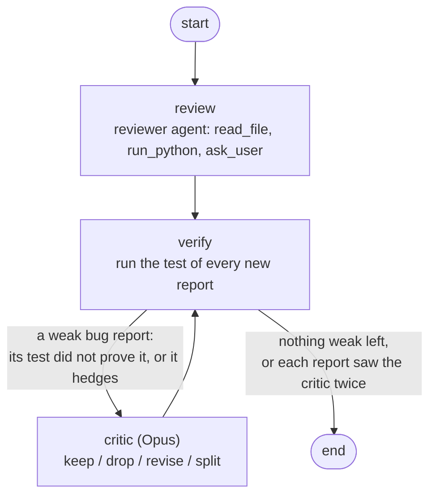
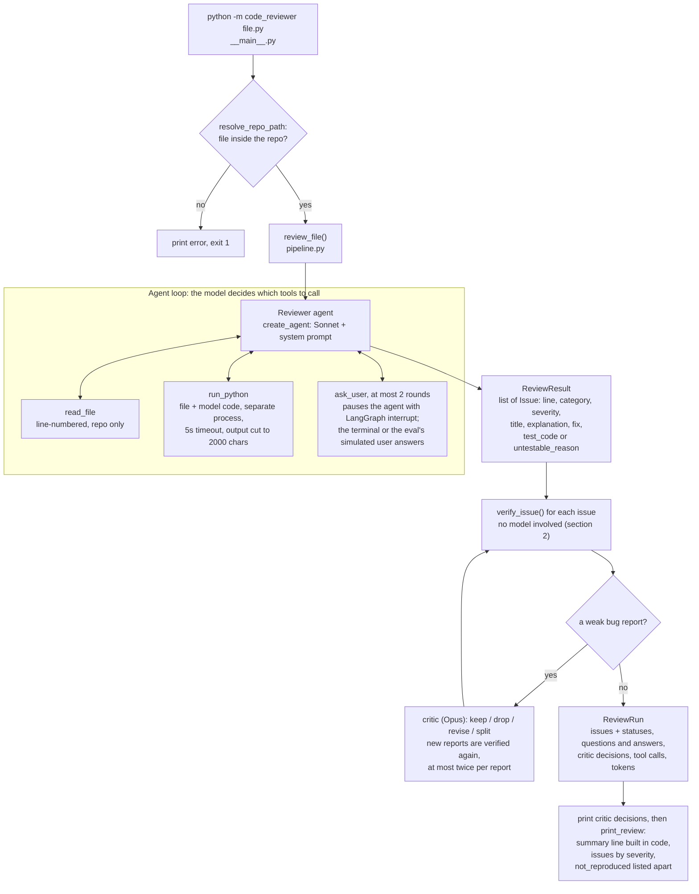
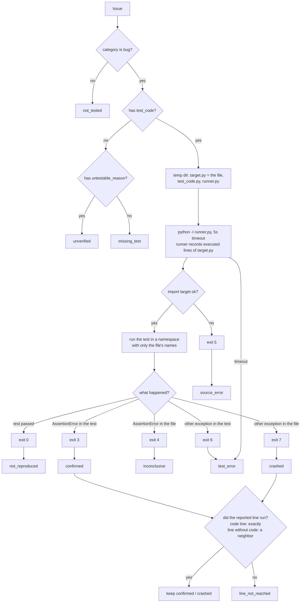
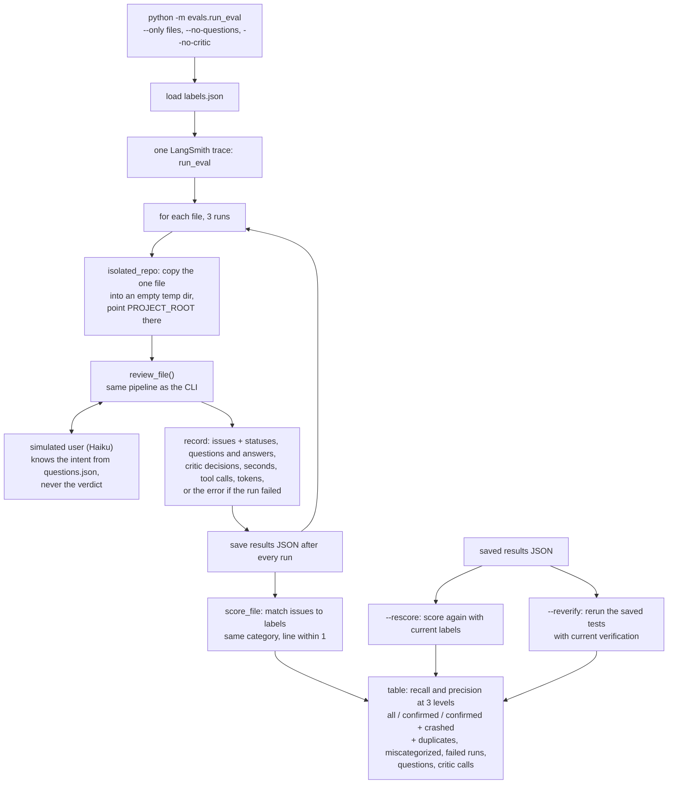

# Pipeline

How a file goes from the command line to a verified review, and how the eval uses the same path.

## The review graph

`review_file()` runs a LangGraph `StateGraph`. The critic is a second, stronger model, and only weak bug reports reach it.

Regenerate the plain version from the code with `build_review_graph().get_graph().draw_mermaid()`.

## 1. Review

## 2. Verifying one issue

The model only writes the test. This step runs it and decides the status.

## 3. Eval

The eval runs the same `review_file()` as the CLI, on a copy of each dataset file.

